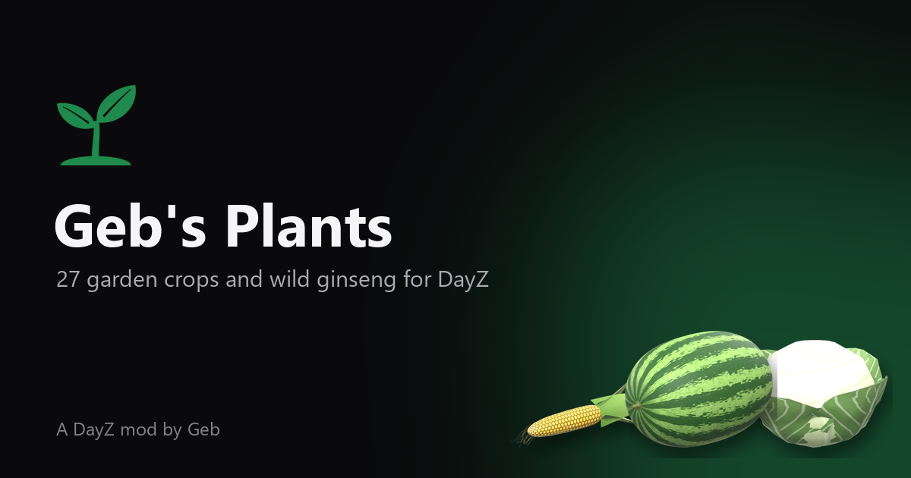

<h1 align="center">
   
  
   
  
  
   
</h1>

<h3 align="center">Garden Crops and Wild Plants for DayZ</h3>

  

  <a href="https://packjc.github.io/gebsplants/">Website</a> •
  <a href="#information">Information</a> •
  <a href="#key-features">Key Features</a> •
  <a href="#installation">Installation</a> •
  <a href="#main-classnames">Classnames</a> •
  <a href="#support">Support</a> •
  <a href="#license--terms">License & Terms</a>

## Information

Geb's Plants adds 27 garden crops and wild ginseng to DayZ. Every crop grows from its own seed packet through five stages in a garden plot, and the harvest can be eaten raw, baked, boiled or dried.

## Key Features

* **Gardening**: 27 crops to grow in a garden plot (corn, okra, green beans, onions, garlic, yellow squash, watermelon, cantaloupe, carrots, cucumbers, barley, tobacco, cabbage, collards, sweet potatoes, beets, radishes, turnips, peas, pole beans, peanuts, strawberries, hops, sorghum, sunflowers, leeks and ginseng), each from its own seed packet through five growth stages to a harvest you can eat raw, bake, boil or dry.
* **Seed saving**: cut, thresh or shell fresh seeds back out of a raw crop with a blade (garlic splits into cloves and sweet potatoes into seed pieces; some crops come from packets only). Watermelons and cantaloupes are cut into slices with a blade, like vanilla's pumpkin.
* **Tobacco**: tie leaves into hands, cure them in the smoke of a stone oven, a closed barrel stove or an indoor fireplace, and bale them with rope.
* **Wild plants**: wild American ginseng ("sang") grows on the forest floor near players, like vanilla's mushrooms, in shady hardwood coves. Chew the root, boil it into a tea or dry it to keep, or grow it from seed in a garden plot.
* **Server-controlled by design**: seed packets are ordinary loot and wild plants join the vanilla forest-floor events. Add only what you want.
* **Localization**: a DayZ `stringtable.csv` for the supported interface languages.

## Installation

1. Subscribe to Geb's Plants on the [Steam Workshop](https://steamcommunity.com/workshop/browse/?appid=221100&searchtext=Geb%27s+Plants).
2. Install the published `@gebsplants` folder beside the DayZ server executable.
3. Copy the included `.bikey` into the server's `keys` folder.
4. Add `-mod=@gebsplants` to the server launch parameters. Every connecting player must load the same Workshop mod.
5. Add the seed packets and wild ginseng to the mission's `types.xml`, and ginseng to the vanilla `TrajectoryDeciduous` event.

The [server-owner guide](https://packjc.github.io/gebsplants/#setup) walks through every step, with copy-ready XML.

## Main Classnames

| Category | Classnames |
| --- | --- |
| Garden crops | `geb_Barley`, `geb_Beets`, `geb_Cabbage`, `geb_Cantaloupe`, `geb_CantaloupeSlice`, `geb_Carrot`, `geb_Collards`, `geb_Cucumber`, `geb_Corn`, `geb_Garlic`, `geb_GreenBeans`, `geb_TobaccoLeaves`, `geb_TobaccoHand`, `geb_HopCones`, `geb_Leek`, `geb_Okra`, `geb_Onion`, `geb_PeaPods`, `geb_Peanuts`, `geb_PoleBeans`, `geb_Radishes`, `geb_Sorghum`, `geb_Strawberries`, `geb_SunflowerHead`, `geb_SweetPotato`, `geb_TobaccoBale`, `geb_Turnip`, `geb_Watermelon`, `geb_WatermelonSlice`, `geb_YellowSquash` |
| Seed packets | `geb_BarleySeedsPack`, `geb_BeetSeedsPack`, `geb_CabbageSeedsPack`, `geb_CantaloupeSeedsPack`, `geb_CarrotSeedsPack`, `geb_CollardSeedsPack`, `geb_CucumberSeedsPack`, `geb_GinsengSeedsPack`, `geb_PoleBeanSeedsPack`, `geb_GreenBeanSeedsPack`, `geb_HopRhizomesPack`, `geb_LeekSeedsPack`, `geb_OkraSeedsPack`, `geb_OnionSeedsPack`, `geb_PeaSeedsPack`, `geb_PeanutSeedsPack`, `geb_RadishSeedsPack`, `geb_GarlicClovesPack`, `geb_SorghumSeedsPack`, `geb_StrawberrySeedsPack`, `geb_SunflowerSeedsPack`, `geb_CornSeedsPack`, `geb_SweetPotatoSeedPiecesPack`, `geb_TobaccoSeedsPack`, `geb_TurnipSeedsPack`, `geb_WatermelonSeedsPack`, `geb_YellowSquashSeedsPack` |
| Seeds | `geb_BarleySeeds`, `geb_GreenBeanSeeds`, `geb_BeetSeeds`, `geb_CabbageSeeds`, `geb_CantaloupeSeeds`, `geb_CarrotSeeds`, `geb_CollardSeeds`, `geb_CornSeeds`, `geb_CucumberSeeds`, `geb_PeaSeeds`, `geb_GarlicCloves`, `geb_GinsengSeeds`, `geb_HopRhizomes`, `geb_LeekSeeds`, `geb_OkraSeeds`, `geb_OnionSeeds`, `geb_PoleBeanSeeds`, `geb_RadishSeeds`, `geb_PeanutSeeds`, `geb_SorghumSeeds`, `geb_YellowSquashSeeds`, `geb_StrawberrySeeds`, `geb_SunflowerSeeds`, `geb_SweetPotatoSeedPieces`, `geb_TobaccoSeeds`, `geb_TurnipSeeds`, `geb_WatermelonSeeds` |
| Plants | `geb_Plant_Barley`, `geb_Plant_Beets`, `geb_Plant_GreenBeans`, `geb_Plant_Cabbage`, `geb_Plant_Cantaloupe`, `geb_Plant_Carrot`, `geb_Plant_Collards`, `geb_Plant_Corn`, `geb_Plant_Cucumber`, `geb_Plant_Garlic`, `geb_Plant_Ginseng`, `geb_Plant_Hops`, `geb_Plant_Leek`, `geb_Plant_Okra`, `geb_Plant_Onion`, `geb_Plant_Peas`, `geb_Plant_Peanuts`, `geb_Plant_PoleBeans`, `geb_Plant_Radish`, `geb_Plant_Sorghum`, `geb_Plant_Strawberries`, `geb_Plant_Sunflower`, `geb_Plant_SweetPotato`, `geb_Plant_Tobacco`, `geb_Plant_Turnip`, `geb_Plant_Watermelon`, `geb_Plant_YellowSquash` |
| Wild plants | `geb_Ginseng` |

The complete searchable list of 112 public config classes is on the [project website](https://packjc.github.io/gebsplants/#classnames).

## The Geb's family

This mod is one of three that used to be **Geb's Flora & Fauna**. Each now stands alone, so a server can run the ones it wants:

* [Geb's Animals](https://github.com/PackJC/gebsanimals) ([website](https://packjc.github.io/gebsanimals/)): 15 wildlife species
* [Geb's Plants](https://github.com/PackJC/gebsplants) ([website](https://packjc.github.io/gebsplants/)): 27 garden crops and wild ginseng
* [Geb's Mushrooms](https://github.com/PackJC/gebsmushrooms) ([website](https://packjc.github.io/gebsmushrooms/)): 63 edible and poisonous fungi

The classnames are unchanged. A server that ran Geb's Flora & Fauna should load all three to keep every item players already have; leaving one out deletes its items from the server's storage at the next restart.

## Support

* [Discord](https://discord.gg/G8uSGZ8yyf)
* [GitHub issues](https://github.com/PackJC/gebsplants/issues)
* [Steam Workshop](https://steamcommunity.com/workshop/browse/?appid=221100&searchtext=Geb%27s+Plants)

## License & Terms

The Steam Workshop item is the authorized distribution source. Do not re-upload, repack, mirror, or include the mod in a server/mod pack. Use a Steam Collection to publish a server's required mod list. Refer to the Workshop page for the complete current terms.

Copyright 2022–2026 Cole / PackJC.
