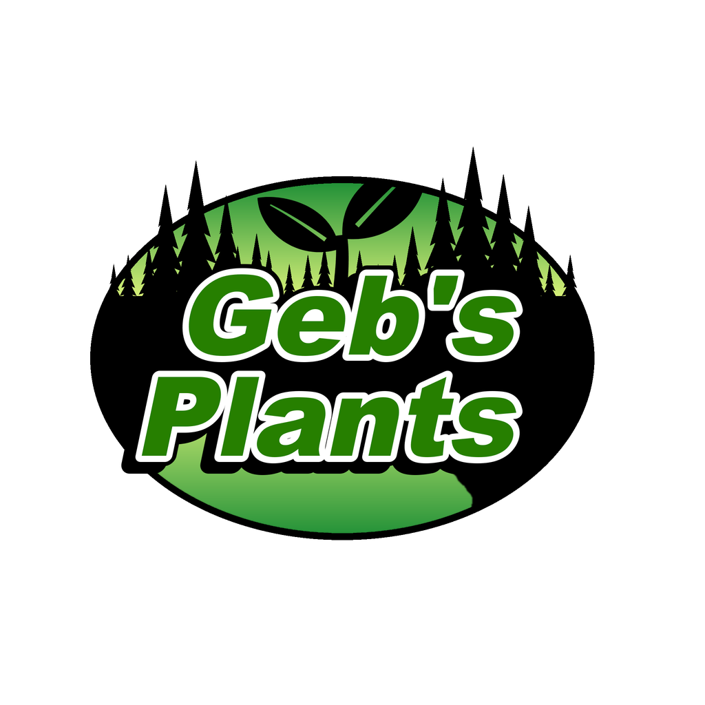

<h1 align="center">
   
  
   
  
   
</h1>

<h3 align="center">Garden Crops and Wild Plants for DayZ</h3>

  
  
  

  <a href="https://packjc.github.io/gebsplants/">Website</a> •
  <a href="#key-features">Key Features</a> •
  <a href="#installation">Installation</a> •
  <a href="#main-classnames">Classnames</a> •
  <a href="#credits">Credits</a> •
  <a href="#license">License & Terms</a> •
  <a href='CHANGELOG.md'>Change Log</a>

## Information

Geb's Plants adds 27 garden crops and wild ginseng to DayZ.
Every crop grows from its own seed packet through five stages in a garden plot, and the harvest can be eaten raw, baked, boiled or dried.

## Requirements

* DayZ 1.30. No other mods are needed: load Geb's Plants on both the server and every client.

## Key Features

* **Gardening**: 27 crops to grow in a garden plot (corn, okra, green beans, onions, garlic, yellow squash, watermelon, cantaloupe, carrots, cucumbers, barley, tobacco, cabbage, collards, sweet potatoes, beets, radishes, turnips, peas, pole beans, peanuts, strawberries, hops, sorghum, sunflowers, leeks and ginseng), each from its own seed packet through five growth stages to a harvest you can eat raw, bake, boil or dry.
* **Seed saving**: cut, thresh or shell fresh seeds back out of a raw crop with a blade (garlic splits into cloves and sweet potatoes into seed pieces; some crops come from packets only). Watermelons and cantaloupes are cut into slices with a blade, like vanilla's pumpkin.
* **Tobacco**: tie leaves into hands, cure them in the smoke of a stone oven, a closed barrel stove or an indoor fireplace, and bale them with rope.
* **Wild plants**: wild American ginseng ("sang") grows on the forest floor near players, like vanilla's mushrooms, in shady hardwood coves. Chew the root, boil it into a tea or dry it to keep, or grow it from seed in a garden plot.
* **Server-controlled by design**: seed packets are ordinary loot and wild plants join the vanilla forest-floor events. Add only what you want.
* Supported languages:
  - English
  - Czech
  - German
  - Russian
  - Polish
  - Hungarian
  - Italian
  - Spanish
  - French
  - Chinese (Traditional and Simplified)
  - Japanese
  - Portuguese
  > **Note**
  > Although supported languages are listed above, we cannot verify complete accuracy. If you are a native speaker and notice anything wrong, please reach out to us in the Discord via a ticket to assist us in getting proper translations.

## Installation

1. Subscribe to Geb's Plants on the [Steam Workshop](https://steamcommunity.com/workshop/browse/?appid=221100&searchtext=Geb%27s+Plants).
2. Install the published `@gebsplants` folder beside the DayZ server executable.
3. Copy the included `.bikey` into the server's `keys` folder.
4. Add `-mod=@gebsplants` to the server launch parameters. Every connecting player must load the same Workshop mod.
5. Add the seed packets and wild ginseng to the mission's `types.xml`, and ginseng to the vanilla `TrajectoryDeciduous` event.

The [server-owner guide](https://packjc.github.io/gebsplants/#setup) walks through every step, with copy-ready XML.

## Main Classnames

| Category | Classnames |
| --- | --- |
| Garden crops | `geb_Barley`, `geb_Beets`, `geb_Cabbage`, `geb_Cantaloupe`, `geb_CantaloupeSlice`, `geb_Carrot`, `geb_Collards`, `geb_Cucumber`, `geb_Corn`, `geb_Garlic`, `geb_GreenBeans`, `geb_TobaccoLeaves`, `geb_TobaccoHand`, `geb_HopCones`, `geb_Leek`, `geb_Okra`, `geb_Onion`, `geb_PeaPods`, `geb_Peanuts`, `geb_PoleBeans`, `geb_Radishes`, `geb_Sorghum`, `geb_Strawberries`, `geb_SunflowerHead`, `geb_SweetPotato`, `geb_TobaccoBale`, `geb_Turnip`, `geb_Watermelon`, `geb_WatermelonSlice`, `geb_YellowSquash` |
| Seed packets | `geb_BarleySeedsPack`, `geb_BeetSeedsPack`, `geb_CabbageSeedsPack`, `geb_CantaloupeSeedsPack`, `geb_CarrotSeedsPack`, `geb_CollardSeedsPack`, `geb_CucumberSeedsPack`, `geb_GinsengSeedsPack`, `geb_PoleBeanSeedsPack`, `geb_GreenBeanSeedsPack`, `geb_HopRhizomesPack`, `geb_LeekSeedsPack`, `geb_OkraSeedsPack`, `geb_OnionSeedsPack`, `geb_PeaSeedsPack`, `geb_PeanutSeedsPack`, `geb_RadishSeedsPack`, `geb_GarlicClovesPack`, `geb_SorghumSeedsPack`, `geb_StrawberrySeedsPack`, `geb_SunflowerSeedsPack`, `geb_CornSeedsPack`, `geb_SweetPotatoSeedPiecesPack`, `geb_TobaccoSeedsPack`, `geb_TurnipSeedsPack`, `geb_WatermelonSeedsPack`, `geb_YellowSquashSeedsPack` |
| Seeds | `geb_BarleySeeds`, `geb_GreenBeanSeeds`, `geb_BeetSeeds`, `geb_CabbageSeeds`, `geb_CantaloupeSeeds`, `geb_CarrotSeeds`, `geb_CollardSeeds`, `geb_CornSeeds`, `geb_CucumberSeeds`, `geb_PeaSeeds`, `geb_GarlicCloves`, `geb_GinsengSeeds`, `geb_HopRhizomes`, `geb_LeekSeeds`, `geb_OkraSeeds`, `geb_OnionSeeds`, `geb_PoleBeanSeeds`, `geb_RadishSeeds`, `geb_PeanutSeeds`, `geb_SorghumSeeds`, `geb_YellowSquashSeeds`, `geb_StrawberrySeeds`, `geb_SunflowerSeeds`, `geb_SweetPotatoSeedPieces`, `geb_TobaccoSeeds`, `geb_TurnipSeeds`, `geb_WatermelonSeeds` |
| Plants | `geb_Plant_Barley`, `geb_Plant_Beets`, `geb_Plant_GreenBeans`, `geb_Plant_Cabbage`, `geb_Plant_Cantaloupe`, `geb_Plant_Carrot`, `geb_Plant_Collards`, `geb_Plant_Corn`, `geb_Plant_Cucumber`, `geb_Plant_Garlic`, `geb_Plant_Ginseng`, `geb_Plant_Hops`, `geb_Plant_Leek`, `geb_Plant_Okra`, `geb_Plant_Onion`, `geb_Plant_Peas`, `geb_Plant_Peanuts`, `geb_Plant_PoleBeans`, `geb_Plant_Radish`, `geb_Plant_Sorghum`, `geb_Plant_Strawberries`, `geb_Plant_Sunflower`, `geb_Plant_SweetPotato`, `geb_Plant_Tobacco`, `geb_Plant_Turnip`, `geb_Plant_Watermelon`, `geb_Plant_YellowSquash` |
| Wild plants | `geb_Ginseng` |

The complete searchable list of 112 public config classes is on the [project website](https://packjc.github.io/gebsplants/#classnames).

## The Geb's family

This mod is one of three that used to be **Geb's Flora & Fauna**. Each now stands alone, so a server can run the ones it wants:

* [Geb's Animals](https://github.com/PackJC/gebsanimals) ([website](https://packjc.github.io/gebsanimals/)): 15 wildlife species
* [Geb's Plants](https://github.com/PackJC/gebsplants) ([website](https://packjc.github.io/gebsplants/)): 27 garden crops and wild ginseng
* [Geb's Mushrooms](https://github.com/PackJC/gebsmushrooms) ([website](https://packjc.github.io/gebsmushrooms/)): 63 edible and poisonous fungi

The classnames are unchanged. A server that ran Geb's Flora & Fauna should load all three to keep every item players already have; leaving one out deletes its items from the server's storage at the next restart.

## Credits

- Geb, creator and author
- The DayZ community for reporting bugs and inspiration throughout the life of the mod

## Support

If you like this project and think it has improved your server in any way, consider contributing! We are always looking for help with ideas, new models, and any monetary support that can help improve the mod. Open a ticket in the [Discord](https://discord.gg/G8uSGZ8yyf) to discuss how you can contribute, or report a bug on [GitHub](https://github.com/PackJC/gebsplants/issues).

## License

[Attribution-NonCommercial-NoDerivatives 4.0 International](https://github.com/PackJC/gebsplants/blob/master/LICENSE)

## Usage & Terms
This item is NOT authorized (strictly forbidden) for any of these conditions:
- posting on Steam, except under the Steam account Cole.
- hosting on any download server other than Geb's Plants current workshop download.
- hosting on any launcher for distribution other than Geb's Plants current workshop download.
- to be packaged in any form other than Geb's Plants current workshop download.
- to create derivative works.

## PERMISSION IS NOT GRANTED FOR THIS MOD TO BE INCLUDED IN A "SERVER PACK" or "MOD PACK" DO NOT EVEN ASK TO REPACK. NO. NOT ALLOWED.
Use a Collection if you want to include this mod on your server for your users.

## Monetization
You are hereby given monetization approval under the conditions that you follow the DayZ Server Monetization agreement and have obtained permission from Bohemia. Read more here https://www.bohemia.net/monetization

## Donations
We accept donations at https://www.paypal.com/paypalme/packjc every dollar counts and we greatly appreciate any contributions!

### Copyright © Smoky Mountain Software 2022-2026
